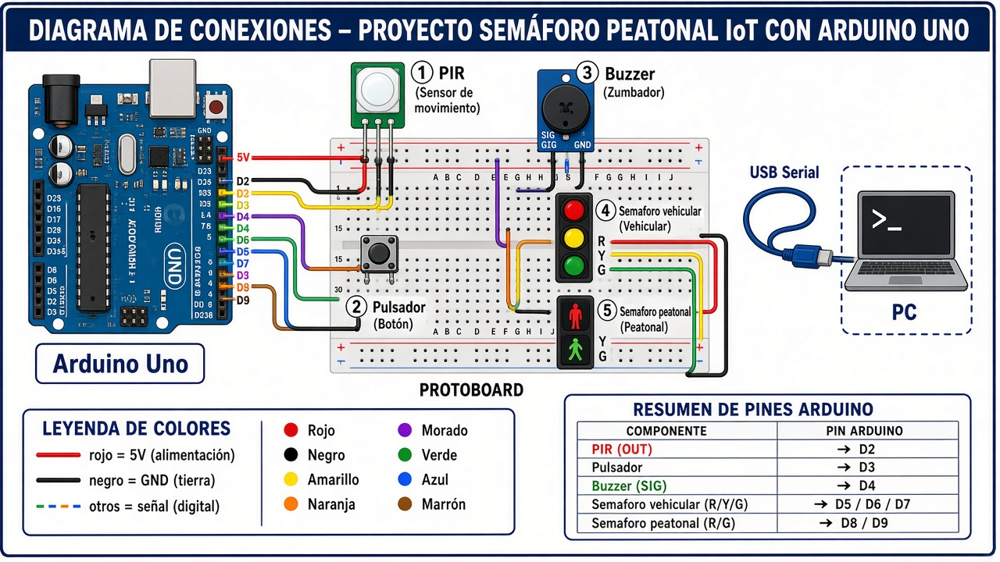

# Guía de montaje — SemaforoIA (Arduino Uno)

Diagrama de referencia:

## Materiales

- Arduino Uno + cable USB A-B
- Protoboard
- Jumpers macho-macho (rojos, negros y de color)
- Sensor PIR
- Pulsador
- Buzzer (módulo o 2 pines)
- 2 módulos de semáforo (vehicular R/Y/G + peatonal R/G)

## Tabla de pines

| # | Componente | Pin módulo | Pin Arduino | Color sugerido |
|---|---|---|---|---|
| 1 | Alimentación | — | 5V → rail + | Rojo |
| 2 | Tierra | — | GND → rail − | Negro |
| 3 | PIR | VCC | rail 5V | Rojo |
| 4 | PIR | GND | rail GND | Negro |
| 5 | PIR | OUT | **D2** | Amarillo |
| 6 | Pulsador | pata A | **D3** | Naranja |
| 7 | Pulsador | pata B | rail GND | Negro |
| 8 | Buzzer | SIG / + | **D4** | Morado |
| 9 | Buzzer | GND / − | rail GND | Negro |
| 10 | Buzzer (módulo) | VCC | rail 5V | Rojo |
| 11 | Sem. vehicular | R | **D5** | Rojo señal |
| 12 | Sem. vehicular | Y | **D6** | Amarillo |
| 13 | Sem. vehicular | G | **D7** | Verde |
| 14 | Sem. vehicular | GND | rail GND | Negro |
| 15 | Sem. peatonal | R | **D8** | Rojo señal |
| 16 | Sem. peatonal | G | **D9** | Verde |
| 17 | Sem. peatonal | GND | rail GND | Negro |
| 18 | PC | USB | puerto USB del Uno | Cable USB |

## Pasos de montaje

### Paso 0 — Seguridad

1. Desconecta el USB del Arduino antes de cablear.
2. No mezcles 5V con pines de señal.
3. Verifica la serigrafía del PIR (`VCC`, `OUT`, `GND`; el orden puede variar).

### Paso 1 — Rails de alimentación

1. Coloca el protoboard junto al Arduino.
2. Cable rojo: `5V` del Uno → rail positivo (+) del protoboard.
3. Cable negro: `GND` del Uno → rail negativo (−) del protoboard.
4. Si usas ambos lados del protoboard, puentea los rails + y los − entre sí.

### Paso 2 — Sensor PIR

1. `VCC` → rail 5V.
2. `GND` → rail GND.
3. `OUT` → **D2**.
4. Ajusta sensibilidad media y retardo bajo para pruebas.

### Paso 3 — Pulsador

1. Inserta el pulsador a caballo sobre el canal central del protoboard.
2. Una pata → **D3**.
3. La pata opuesta → rail **GND**.
4. El firmware usa `INPUT_PULLUP`: en reposo HIGH; al pulsar, LOW.

### Paso 4 — Buzzer

1. Módulo 3 pines: `VCC`→5V, `GND`→GND, `SIG`→**D4**.
2. Buzzer 2 pines: positivo→**D4**, negativo→GND.

### Paso 5 — Semáforo vehicular

1. R→**D5**, Y→**D6**, G→**D7**, GND→rail GND.
2. Si no trae resistencias y los LEDs brillan en exceso, añade 220 Ω en serie.

### Paso 6 — Semáforo peatonal

1. R→**D8**, G→**D9**, GND→rail GND.
2. Si tiene pin amarillo, déjalo desconectado.

### Paso 7 — USB al PC

1. Conecta USB Uno ↔ PC.
2. En Windows: Administrador de dispositivos → Puertos (COM y LPT) → anota `COMx`.
3. Instala drivers CH340/FTDI solo si el COM no aparece.

### Paso 8 — Prueba rápida

1. Carga `arduino/prueba_pines/prueba_pines.ino`.
2. Verifica LEDs D5–D9 y buzzer en D4.
3. Luego carga `arduino/semaforo_ia/semaforo_ia.ino` (115200 baudios).
4. Monitor Serial: movimiento frente al PIR → evento `pir`; pulsador → evento `button`.

## Luces esperadas por modo

| Modo | Vehicular | Peatonal | Buzzer |
|---|---|---|---|
| REPOSO | VERDE | ROJO | off |
| TRANSICION_AMARILLO | AMARILLO | ROJO | beep opcional |
| FASE_PEATONAL | ROJO | VERDE | on |
| COOLDOWN | VERDE | ROJO | off |
